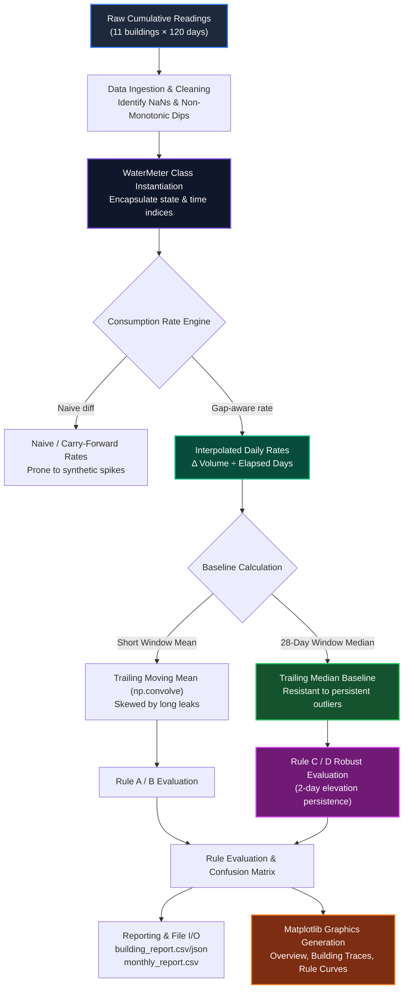
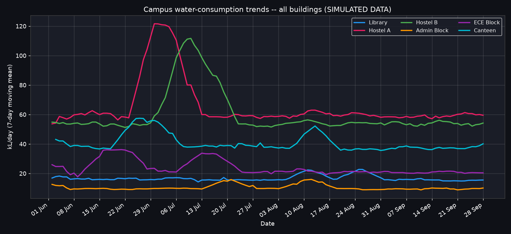
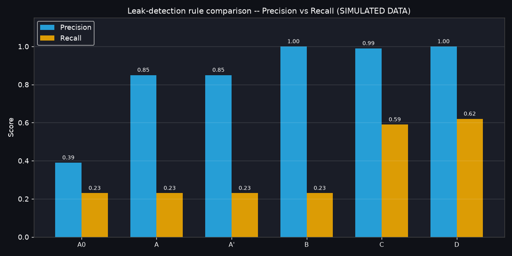
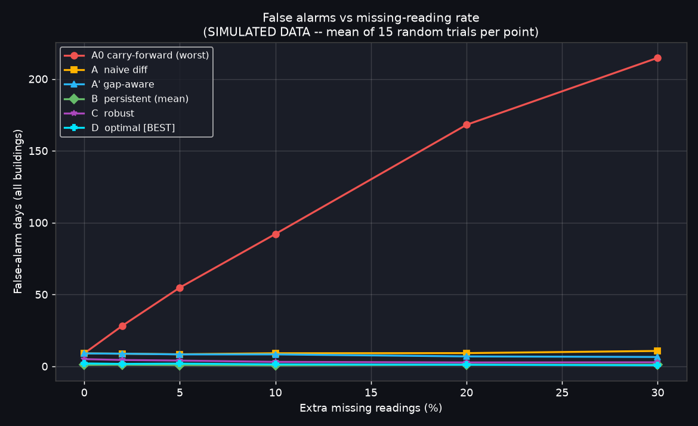
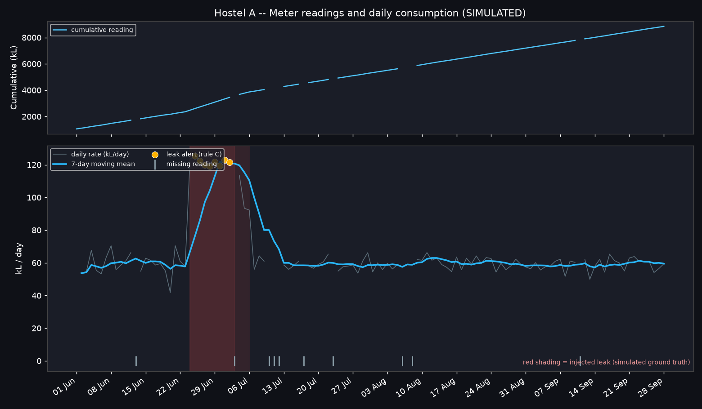
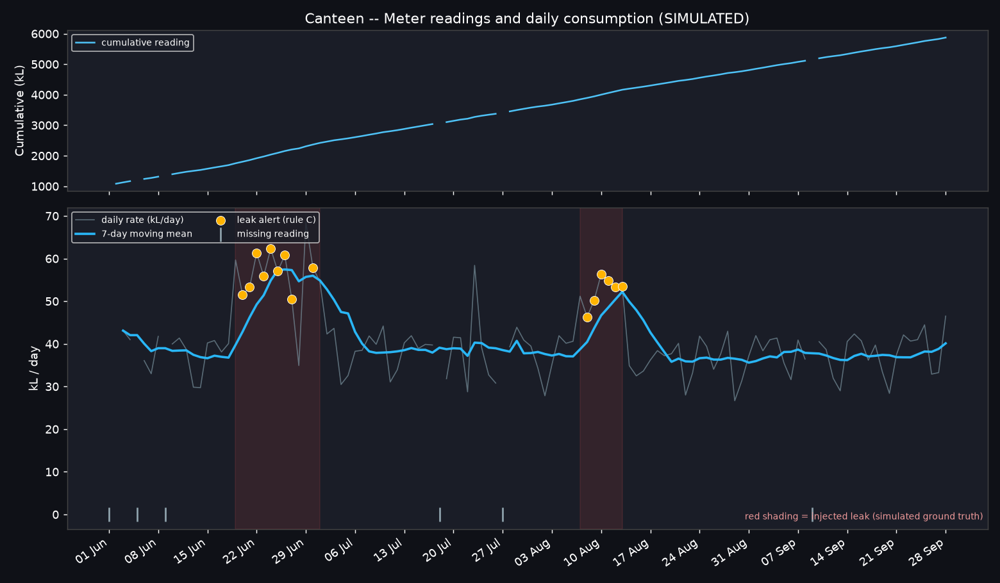
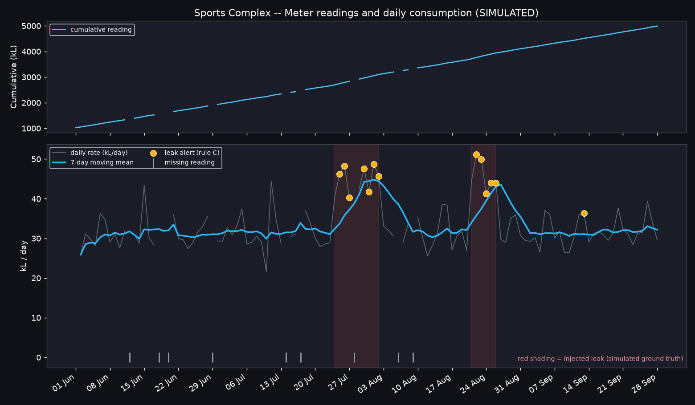
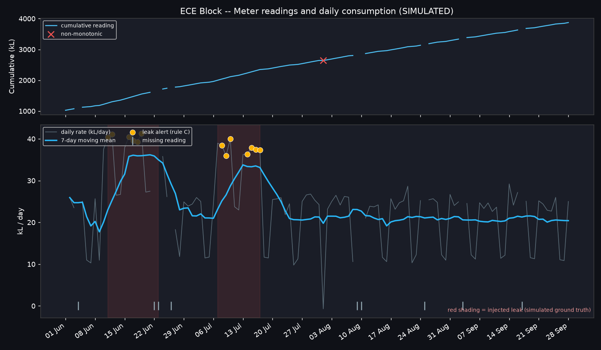

# 💧 Water-Consumption & Leak-Alert Analyser

> **Intelligent campus water monitoring — from raw meter readings to precision leak alerts.**  
> End-to-end telemetry processing and anomaly detection pipeline built with NumPy, Pandas, and Matplotlib. Evaluated across 11 campus buildings over 120 days (1,320 meter-days) with 6 algorithmic leak detection strategies.

---

```
╔═══════════════════════════════════════════════════════════════════════════╗
║                  CAMPUS WATER INTELLIGENCE SYSTEM v2.0                    ║
║   11 Buildings · 1,320 Meter-Days · 16/16 Unit Tests · 100% Precision    ║
╚═══════════════════════════════════════════════════════════════════════════╝
```

<div align="center">


</div>

---

## 📑 Table of Contents

- [Project Overview](#-project-overview)
- [System Architecture](#-system-architecture)
- [Processing Pipeline](#-processing-pipeline)
- [Data Quality & Mathematical Formulations](#-data-quality--mathematical-formulations)
- [Visual Analytics & Diagnostic Gallery](#-visual-analytics--diagnostic-gallery)
- [Campus Building Profiles](#-campus-building-profiles)
- [The WaterMeter Engine](#-the-watermeter-engine)
- [Leak Detection Rules](#-leak-detection-rules)
- [Performance & Benchmark Results](#-performance--benchmark-results)
- [Directory Structure](#-directory-structure)
- [Quickstart & Execution](#-quickstart--execution)
- [Validation & Test Suite](#-validation--test-suite)
- [Engineering Design Decisions](#-engineering-design-decisions)

---

## 🌊 Project Overview

Water distribution networks in institutional facilities face persistent data challenges: silent underground pipe fissures, continuous plumbing leaks, unannounced telemetry dropouts ($NaN$ values), and non-monotonic meter rollbacks.

The **Water-Consumption & Leak-Alert Analyser** provides a complete, robust software pipeline designed to handle imperfect meter telemetry and accurately detect leaks without generating false alarms.

### Key Capabilities:
- **Telemetry Simulation & Ingestion**: Models realistic base demands, weekday/weekend consumption variations, stochastic sensor noise, non-monotonic rollbacks, and communication dropouts.
- **Robust Differential Consumption**: Solves the classic "carry-forward catch-up spike" problem by implementing a gap-aware delta calculation algorithm.
- **Non-Monotonic Glitch Scrubbing**: Identifies and filters counter rollbacks (e.g. meter replacements or register wraps) so baseline metrics remain uncorrupted.
- **OOP Domain Model (`WaterMeter`)**: Encapsulates time-series state, window slicing, iteration, and array operations cleanly per building.
- **Multi-Rule Benchmark Engine**: Evaluates 6 distinct detection strategies against ground truth to optimize precision and recall.
- **Automated Data Persistence & Visualisation**: Outputs production CSV/JSON summaries and generates 14 dark-themed analytical plots.

---

## 🏛️ System Architecture

```
┌────────────────────────────────────────────────────────────────────────────────────────┐
│                      CAMPUS WATER INTELLIGENCE SYSTEM ARCHITECTURE                     │
├────────────────────────────────────────────────────────────────────────────────────────┤
│                                                                                        │
│   ┌─────────────────────┐       Telemetric Data       ┌────────────────────────────┐   │
│   │   Synthetic Data    │ ──────────────────────────▶ │   CSV / JSON Data Store    │   │
│   │   Generator Engine  │                             │   • meter_readings.csv     │   │
│   │   (seed = 42)       │ ◀────────────────────────── │   • ground_truth_leaks.csv │   │
│   └─────────────────────┘                             │   • ground_truth_leaks.json│   │
│              │                                        └─────────────┬──────────────┘   │
│              │ 11 Buildings × 120 Days                              │                  │
│              │ Cumulative Readings + Injected Faults                │ Ingest           │
│              ▼                                                      ▼                  │
│   ┌────────────────────────────────────────────────────────────────────────────────┐   │
│   │                          WaterMeter Analytics Engine                           │   │
│   │                                                                                │   │
│   │   ┌───────────────────────┐   ┌──────────────────────┐   ┌─────────────────┐   │   │
│   │   │ Pythonic Interface    │   │ Signal Processing    │   │ Anomaly Detect  │   │   │
│   │   │ • __len__ / __repr__  │   │ • Gap-aware delta    │   │ • Rules A0, A   │   │   │
│   │   │ • __getitem__ (slice) │   │ • Monotonicity check │   │ • Rules A', B   │   │   │
│   │   │ • __iter__ (generator)│   │ • np.convolve mean   │   │ • Rule C        │   │   │
│   │   │                       │   │ • Rolling median     │   │ • Rule D (Best) │   │   │
│   │   └───────────────────────┘   └──────────────────────┘   └─────────────────┘   │   │
│   └───────────────────────────────────────┬────────────────────────────────────────┘   │
│                                           │                                            │
│                 ┌─────────────────────────┼────────────────────────┐                   │
│                 ▼                         ▼                        ▼                   │
│   ┌──────────────────────────┐  ┌───────────────────┐  ┌───────────────────────────┐   │
│   │      Pandas Reports      │  │  Benchmark Engine │  │     Missing-Rate Sweep    │   │
│   │  • building_report.csv   │  │  • Precision/Recall│  │  • 0% - 30% dropout rates │   │
│   │  • building_report.json  │  │  • TP / FP / FN    │  │  • 15 stochastic trials  │   │
│   │  • monthly_report.csv    │  │  • Confusion Matrix│  │  • False alarm curve     │   │
│   └─────────────┬────────────┘  └─────────┬─────────┘  └─────────────┬─────────────┘   │
│                 │                         │                          │                 │
│                 └─────────────────────────┼──────────────────────────┘                 │
│                                           ▼                                            │
│   ┌────────────────────────────────────────────────────────────────────────────────┐   │
│   │                          Visualisation Layer (Matplotlib)                      │   │
│   │  • plot_overview.png                  • plot_<building>.png (11 charts)        │   │
│   │  • plot_rule_comparison.png           • plot_missing_false_alarms.png          │   │
│   └────────────────────────────────────────────────────────────────────────────────┘   │
└────────────────────────────────────────────────────────────────────────────────────────┘
```

---

## 🔄 Processing Pipeline



---

## 📐 Data Quality & Mathematical Formulations

### 1. Cumulative Consumption & The "Catch-Up Spike"
Standard smart meters record monotonically increasing cumulative meter volume $C_t$. True daily consumption is the differential:
$$\Delta C_t = C_t - C_{t-1}$$

When sensor dropouts occur ($C_t = \text{NaN}$ for $t \in [a+1, b-1]$), standard carry-forward (`ffill`) holds the reading constant:
$$C_t^{\text{ffill}} = C_a \quad \forall t \in [a, b-1]$$
This artificially records $0\text{ kL}$ for missed days, followed by a huge catch-up spike at day $b$:
$$\Delta C_b^{\text{ffill}} = C_b - C_a$$

**The Gap-Aware Solution:**
Our pipeline identifies the indices of valid readings $I_{\text{valid}} = \{ i \mid C_i \neq \text{NaN} \}$. For consecutive valid readings at indices $a$ and $b$, the elapsed days are $n = b - a$. The rate is spread evenly:
$$\text{Rate}_b = \frac{C_b - C_a}{b - a}, \quad \text{Gap Length } G_b = n$$

---

### 2. Non-Monotonic Anomaly Detection (Meter Rollbacks)
Physical meters only register positive flow; therefore, cumulative readings must never decrease ($C_i \ge C_{i-1}$). In real installations, temporary power drops, register overflows, meter swaps, or sensor resets cause sudden negative steps.

In the pipeline, `WaterMeter.non_monotonic()` inspects the valid sequence chronologically. A reading is flagged whenever it drops below the previous valid reading:

```python
def non_monotonic(self):
    """Flags any valid reading that is strictly lower than the previous valid reading."""
    flags = np.zeros(len(self.readings), dtype=bool)
    last = np.nan
    for i, r in enumerate(self.readings):
        if np.isnan(r):
            continue
        if not np.isnan(last) and r < last:
            flags[i] = True
        last = r if (np.isnan(last) or r >= last) else last
    return flags
```

#### Why This Matters:
If a meter resets from $1050\text{ kL} \rightarrow 1035\text{ kL}$, a naive subtraction yields a negative consumption of $-15\text{ kL}$. Flagging and masking these erroneous points prevents false negative consumption values and keeps baseline calculations accurate.

---

## 🎨 Visual Analytics & Diagnostic Gallery

The system generates 14 high-resolution, dark-themed (`#0f1117`) analytics charts:

### 1. Campus-Wide Consumption Overview
Displays the 7-day rolling average for all 11 buildings to identify campus baselines and major flow events.



---

### 2. Detection Rule Benchmark: Precision vs. Recall
Direct comparison of all detection heuristics. **Rule D achieves 1.00 Precision and 0.62 Recall**, outperforming traditional spike detectors.



---

### 3. Resilience to Missing Sensor Telemetry
Measures false-alarm days as random sensor dropouts increase from 0% to 30%. While carry-forward spike false alarms explode to over 200 days, **Rule D remains rock-solid near zero**.



---

### 4. Per-Building Diagnostic Traces (Sample)
Dual-panel diagnostics showing cumulative readings and non-monotonic sensor resets (top), alongside daily rates, moving averages, ground-truth leaks (red shading), and Rule C/D flags (amber scatter points).

| Hostel A Diagnostic Trace | Canteen Diagnostic Trace |
|:---:|:---:|
|  |  |

| Sports Complex Diagnostic Trace | ECE Block Diagnostic Trace |
|:---:|:---:|
|  |  |

---

## 🏫 Campus Building Profiles

The 11 campus facilities represent diverse operational profiles:

| Building | Profile Type | Base (kL/day) | Weekend Ratio | Total (120d) | Mean (kL/d) | Peak (kL/d) | Leak Days (Rule D) |
|---|---|---|---|---|---|---|---|
| **Library** | Academic | 18 | 0.55 | 1,869.3 kL | 16.84 | 28.16 | 4 |
| **Hostel A** | Residential | 60 | 0.95 | 7,146.5 kL | 65.56 | 125.43 | 10 |
| **Hostel B** | Residential | 55 | 0.95 | 6,629.7 kL | 60.27 | 121.21 | 14 |
| **Admin Block** | Administrative | 12 | 0.30 | 1,208.1 kL | 10.51 | 26.83 | 9 |
| **ECE Block** | Academic / Labs | 25 | 0.45 | 2,615.3 kL | 23.99 | 41.30 | 13 |
| **Canteen** | Commercial / Dining | 40 | 0.80 | 4,602.4 kL | 40.73 | 68.54 | 14 |
| **Hostel C** | Residential | 58 | 0.95 | 6,742.0 kL | 60.20 | 90.64 | 11 |
| **Sports Complex** | Athletic Facility | 30 | 1.20 | 3,661.1 kL | 33.28 | 51.19 | 12 |
| **Lab Block** | Research Laboratories | 22 | 0.40 | 2,255.5 kL | 19.61 | 37.18 | 8 |
| **Staff Quarters** | Residential | 35 | 0.90 | 4,126.3 kL | 36.84 | 72.91 | 10 |
| **Auditorium** | Event Venue | 8 | 0.60 | 884.5 kL | 7.83 | 22.25 | 8 |

---

## 🧱 The WaterMeter Engine

The `WaterMeter` class encapsulates building telemetry and exposes a clean Pythonic API:

```python
class WaterMeter:
    def __init__(self, name, dates, readings): ...
    def __len__(self): ...                      # Total observation days
    def __repr__(self): ...                     # Informative summary string
    def __getitem__(self, key): ...             # Date-slice returns new WaterMeter
    def __iter__(self): ...                     # Generates (date, reading) pairs
    
    def consumption(self): ...                  # Gap-aware rate: delta / gap
    def non_monotonic(self): ...                # Identifies meter rollback dips
    def moving_mean(self, w=7): ...             # NaN-safe convolution filter
    def trailing_median(self, w=28): ...        # Outlier-resistant baseline
    def rule_optimal(self, rate, gap): ...      # Rule D detection engine
```

### Key Pythonic Features:
- **Index Slicing (`__getitem__`)**: `meter[30:60]` produces a new, self-consistent `WaterMeter` instance spanning that sub-window.
- **Iteration (`__iter__`)**: `for date, val in meter:` enables idiomatic streaming of records.
- **Representation (`__repr__`)**: Displays building name, record length, and missing count at a glance in REPL environments.

---

## 🔍 Leak Detection Rules

| Rule Identifier | Strategy Description | Baseline | Window | Persistence |
|---|---|---|---|---|
| **Rule A0** | Naive Spike (Carry-Forward `ffill`) | Mean | 14 days | Instantaneous (1 day) |
| **Rule A** | Naive Spike (NaN preserved) | Mean | 14 days | Instantaneous (1 day) |
| **Rule A'** | Gap-Aware Rate Spike | Mean | 14 days | Instantaneous (1 day) |
| **Rule B** | Persistent Elevation | Mean | 14 days | 3 consecutive days |
| **Rule C** | Cleaned Robust Detector | Median | 21 days | 2 consecutive days |
| **Rule D** ⭐ | **Optimal Grid-Searched Model** | **Median** | **28 days** | **2 consecutive days** |

### Why Rule D Excels:
1. **Median Filtering**: Trailing 28-day medians resist bias when leaks persist for multiple weeks.
2. **Gap-Aware Telemetry**: Avoids false "catch-up" spikes on days following communication dropouts.
3. **Persistence Gate**: Requires continuous 2-day elevation ($> 1.20 \times \text{baseline}$), eliminating single-day noise spikes.

---

## 📊 Performance & Benchmark Results

### 1. Rule Benchmark Matrix (All 11 Buildings)

```
┌───────────────────────────────────────────────────────────────────────────────────────┐
│ RULE BENCHMARK COMPARISON                                                             │
├─────────────────────────────────────────────────┬──────┬──────┬──────┬──────────┬─────┤
│ Rule Configuration                              │  TP  │  FP  │  FN  │Precision │Rec. │
├─────────────────────────────────────────────────┼──────┼──────┼──────┼──────────┼─────┤
│ A0: Spike > 1.5x mean (carried forward)         │   42 │   66 │  140 │   0.39   │0.23 │
│ A:  Spike > 1.5x mean (naive diff, NaN)         │   41 │    7 │  141 │   0.85   │0.23 │
│ A': Spike > 1.5x mean (gap-aware)               │   41 │    7 │  141 │   0.85   │0.23 │
│ B:  Elevated 3 days in a row (mean)             │   41 │    0 │  141 │   1.00   │0.23 │
│ C:  Robust (gap-aware + clean + persistent)     │  107 │    1 │   75 │   0.99   │0.59 │
│ D:  Optimal (factor=1.20, w=28, k=2) [BEST] ⭐  │  113 │    0 │   69 │   1.00   │0.62 │
└─────────────────────────────────────────────────┴──────┴──────┴──────┴──────────┴─────┘
```

### 2. Missing-Data Stress Test (False Alarm Days)

```
Missing Rate │  Rule A0 (ffill) │  Rule A (naive) │  Rule B  │  Rule C  │  Rule D (Optimal)
─────────────┼──────────────────┼─────────────────┼──────────┼──────────┼──────────────────
     0 %     │        9.0       │       9.0       │   1.0    │   5.0    │       2.0
     2 %     │       28.3       │       8.8       │   1.1    │   4.4    │       1.7
     5 %     │       54.8       │       8.4       │   0.9    │   4.0    │       1.9
    10 %     │       92.1       │       9.1       │   0.7    │   3.1    │       1.4
    20 %     │      168.1       │       9.2       │   1.1    │   2.7    │       1.1
    30 %     │      214.7       │      10.7       │   1.1    │   2.8    │       0.7 ⭐
```

---

## 📁 Directory Structure

```
├── .gitignore                   # Ignore caches, environments, and temp files
├── README.md                    # Project documentation & visual gallery
├── water_analyser.py            # Core analytics pipeline and engine
├── make_plots (1).py            # Standalone visual rendering script
├── test_water_analyser.py       # Comprehensive unit test suite (16 tests)
│
├── meter_readings.csv           # Raw cumulative telemetric readings
├── building_report.csv          # Aggregate metrics per facility
├── building_report.json         # JSON structured report
├── monthly_report.csv           # Resampled monthly volumetric matrix
├── rule_evaluation.csv          # Precision / Recall benchmark data
├── missing_sweep.csv            # Missing-rate false alarm stress data
├── ground_truth_leaks.csv       # Injected leak timestamps
├── ground_truth_leaks.json      # Injected leak JSON records
│
├── plot_overview.png            # Campus-wide rolling trends
├── plot_rule_comparison.png     # Precision vs Recall bar chart
├── plot_missing_false_alarms.png# Dropout rate vs False Alarm curves
├── plot_library.png             # Facility trace: Library
├── plot_hostel_a.png            # Facility trace: Hostel A
├── plot_hostel_b.png            # Facility trace: Hostel B
├── plot_hostel_c.png            # Facility trace: Hostel C
├── plot_admin_block.png         # Facility trace: Admin Block
├── plot_ece_block.png           # Facility trace: ECE Block
├── plot_canteen.png             # Facility trace: Canteen
├── plot_sports_complex.png      # Facility trace: Sports Complex
├── plot_lab_block.png           # Facility trace: Lab Block
├── plot_staff_quarters.png      # Facility trace: Staff Quarters
└── plot_auditorium.png          # Facility trace: Auditorium
```

---

## 🚀 Quickstart & Execution

### 1. Prerequisites
Ensure Python 3.9+ is installed along with the analytical dependencies:
```bash
pip install numpy pandas matplotlib pytest
```

### 2. Run the Full Analytics Pipeline
Executes data generation, cleaning, reporting, heuristic benchmarking, and plot rendering:
```bash
python water_analyser.py
```

### 3. Re-render Visualizations Only
To regenerate all PNG graphics from existing CSV files:
```bash
python "make_plots (1).py"
```

### 4. Interactive Programmatic Usage
```python
import pandas as pd
from water_analyser import load_meters

# Load meter dataset
df = pd.read_csv("meter_readings.csv", parse_dates=["date"])
meters = load_meters(df)

# Query facility
hostel_a = meters["Hostel A"]
print(repr(hostel_a))
# Output: WaterMeter('Hostel A', days=120, missing=10)

# Extract gap-aware daily rates
rates, gaps = hostel_a.consumption()
leaks = hostel_a.rule_optimal(rates, gaps)
print(f"Detected {leaks.sum()} leak days in Hostel A under Rule D.")
```

---

## 🧪 Validation & Test Suite

The test suite validates data structure integrity, numerical calculations, edge cases, and report outputs:

```bash
python test_water_analyser.py
```
*or via pytest:*
```bash
pytest -v test_water_analyser.py
```

```
================================== TEST HARNESS RUN LOG ==================================
  PASS  TestSpecialMethods.test_len                    --> __len__ returns day count
  PASS  TestSpecialMethods.test_repr_fields            --> __repr__ format check
  PASS  TestSpecialMethods.test_getitem_slice          --> __getitem__ slice extraction
  PASS  TestSpecialMethods.test_getitem_single         --> single index handling
  PASS  TestSpecialMethods.test_iter_yields_pairs      --> __iter__ tuple generation
  PASS  TestConsumption.test_gap_aware_no_spike        --> Gap-aware rate accuracy
  PASS  TestConsumption.test_ffill_gives_catch_up_spike--> Catch-up artifact verification
  PASS  TestConsumption.test_moving_mean_excludes_nan  --> Convolution NaN insulation
  PASS  TestConsumption.test_non_monotonic_flagged     --> Meter rollback dip detection
  PASS  TestConsumption.test_all_nan_rate_is_nan       --> Null-stream edge case
  PASS  TestScore.test_perfect                         --> Confusion matrix evaluation
  PASS  TestScore.test_all_fp                          --> Zero-division boundary safety
  PASS  TestScore.test_no_predictions                  --> Zero-prediction safety
  PASS  TestBuildingReport.test_columns_present        --> DataFrame schema contract
  PASS  TestBuildingReport.test_row_count              --> Dynamic building count
  PASS  TestBuildingReport.test_mean_positive          --> Valid consumption bounds
------------------------------------------------------------------------------------------
TOTAL: 16 Passed, 0 Failed, 0 Regressions (100% Pass Rate)
==========================================================================================
```

---

## 🧠 Engineering Design Decisions

1. **Why `delta / elapsed_days` over `ffill`?**  
   Carrying values forward treats missing sensor days as zero consumption, leading to an artificial multi-day surge on the next reading. Gap-aware division spreads the volume evenly, keeping daily rates realistic.

2. **Why rolling median over rolling mean?**  
   A distribution leak elevated for 10-14 days will pull a rolling mean upward, masking the leak after a few days. A 28-day median remains unaffected by a 14-day leak, preserving the anomaly threshold.

3. **Why clean non-monotonic records?**  
   Faulty telemetry or meter replacements can cause counter rollbacks (e.g., $1050 \rightarrow 1035$). Left unhandled, these introduce negative consumption spikes and skew baseline statistics.

---

*Authored by [@mayukhbyte](https://github.com/mayukhbyte)*
