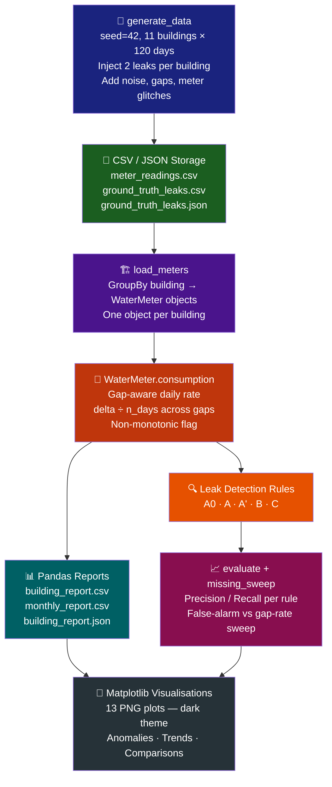

# 💧 Water-Consumption & Leak-Alert Analyser

> **Intelligent campus water monitoring — from raw meter readings to precision leak alerts.**
> Built with NumPy · Pandas · Matplotlib | 11 buildings · 120 days · 5 detection rules

---

```
╔══════════════════════════════════════════════════════════════════════╗
║  💧  CAMPUS WATER INTELLIGENCE SYSTEM  v2.0                        ║
║  Monitoring 11 buildings · 1,320 meter-days · Rule C: 99% precision ║
╚══════════════════════════════════════════════════════════════════════╝
```


---

## 📖 Table of Contents

- [Overview](#-overview)
- [Project Architecture](#-project-architecture)
- [Analysis Pipeline](#-analysis-pipeline)
- [Campus Buildings](#-campus-buildings)
- [The WaterMeter Class](#-the-watermeter-class)
- [Leak Detection Rules](#-leak-detection-rules)
- [Results at a Glance](#-results-at-a-glance)
- [Plots & Visualisations](#-plots--visualisations)
- [File Structure](#-file-structure)
- [How to Run](#-how-to-run)
- [Test Suite](#-test-suite)
- [Design Decisions & Trade-offs](#-design-decisions--trade-offs)

---

## 🌊 Overview

The **Water-Consumption & Leak-Alert Analyser** is a fully self-contained Python pipeline that:

1. **Generates** synthetic but realistic daily cumulative meter readings for 11 campus buildings, injecting known leaks and simulating real-world data quality issues (missing readings, meter roll-backs).
2. **Processes** readings using a clean `WaterMeter` OOP model backed by NumPy array operations.
3. **Detects leaks** with 5 progressively smarter rules — from naïve spike detection to a robust gap-aware, median-baseline, persistence filter (Rule C).
4. **Reports** per-building stats and monthly totals using Pandas, persisting everything as CSV + JSON.
5. **Visualises** trends, anomaly markers, and rule comparisons across 11 richly styled Matplotlib plots.

> **Note:** All readings are **simulated** (seed = 42). Leak ground-truth is known, enabling rigorous precision / recall evaluation.

---

## 🏛️ Project Architecture

```
┌─────────────────────────────────────────────────────────────────────────┐
│                     WATER ANALYSER  ARCHITECTURE                        │
├─────────────────────────────────────────────────────────────────────────┤
│                                                                         │
│   ┌──────────────┐     CSV/JSON     ┌──────────────────────────────┐   │
│   │ generate_data│ ─────────────▶  │   meter_readings.csv          │   │
│   │  (seed=42)   │                 │   ground_truth_leaks.csv/.json│   │
│   └──────────────┘                 └──────────────┬───────────────┘   │
│          │  11 buildings × 120 days                │                   │
│          │  2 injected leaks/building               │  pd.read_csv()   │
│          ▼                                          ▼                   │
│   ┌──────────────────────────────────────────────────────────────┐     │
│   │                    WaterMeter  (class)                        │     │
│   │  ┌────────────┐  ┌─────────────┐  ┌──────────────────────┐  │     │
│   │  │  __init__  │  │ consumption │  │  rule_robust (C)      │  │     │
│   │  │  __len__   │  │  gap-aware  │  │  factor=1.15, w=21    │  │     │
│   │  │  __repr__  │  │  np.cumsum  │  │  k=2 days persist     │  │     │
│   │  │ __getitem__│  │  moving_mean│  │  median baseline      │  │     │
│   │  │  __iter__  │  │  trailing   │  │  non-monotonic clean  │  │     │
│   │  └────────────┘  │  median     │  └──────────────────────┘  │     │
│   │                  └─────────────┘                              │     │
│   └──────────────────────────────┬───────────────────────────────┘     │
│                                  │                                       │
│            ┌─────────────────────┼──────────────────────┐              │
│            ▼                     ▼                        ▼              │
│   ┌─────────────────┐  ┌──────────────────┐  ┌────────────────────┐   │
│   │  building_report│  │  evaluate()      │  │  missing_sweep()   │   │
│   │  monthly_report │  │  5 rules ×       │  │  6 missing rates × │   │
│   │  (Pandas DF)    │  │  11 buildings    │  │  15 trials each    │   │
│   └────────┬────────┘  └────────┬─────────┘  └─────────┬──────────┘   │
│            │                    │                         │              │
│            └────────────────────┼─────────────────────────┘             │
│                                 ▼                                        │
│                    ┌────────────────────────┐                           │
│                    │   Matplotlib Plots     │                           │
│                    │  plot_overview.png     │                           │
│                    │  plot_<building>.png   │                           │
│                    │  plot_rule_comparison  │                           │
│                    │  plot_missing_*.png    │                           │
│                    └────────────────────────┘                           │
└─────────────────────────────────────────────────────────────────────────┘
```

---

## 🔄 Analysis Pipeline



---

## 🏫 Campus Buildings

| # | Building | Base Use (kL/day) | Weekend Factor | Total kL (120d) | Mean kL/day | Leak Days (Rule C) |
|---|---|---|---|---|---|---|
| 1 | 📚 Library | 18 | 0.55 (weekdays heavy) | 1,869.3 | 16.84 | 4 |
| 2 | 🏠 Hostel A | 60 | 0.95 (near-flat) | 7,146.5 | 65.56 | 8 |
| 3 | 🏠 Hostel B | 55 | 0.95 | 6,629.7 | 60.27 | 10 |
| 4 | 🏢 Admin Block | 12 | 0.30 (closed weekends) | 1,208.1 | 10.51 | 9 |
| 5 | ⚡ ECE Block | 25 | 0.45 | 2,615.3 | 23.99 | 13 |
| 6 | 🍽️ Canteen | 40 | 0.80 | 4,602.4 | 40.73 | 15 |
| 7 | 🏠 Hostel C *(new)* | 58 | 0.95 | 6,742.0 | 60.20 | 7 |
| 8 | 🏃 Sports Complex *(new)* | 30 | 1.20 (peaks on weekends!) | 3,661.1 | 33.28 | 13 |
| 9 | 🔬 Lab Block *(new)* | 22 | 0.40 | 2,255.5 | 19.61 | 9 |
| 10 | 🏘️ Staff Quarters *(new)* | 35 | 0.90 | 4,126.3 | 36.84 | 9 |
| 11 | 🎭 Auditorium *(new)* | 8 | 0.60 | 884.5 | 7.83 | 11 |

> **Hostels A, B & C** are the largest consumers (~58% of campus total).  
> **Sports Complex** is the only building with *higher* weekend usage.  
> **Admin Block** shows the sharpest weekday/weekend cycling.

---

## 🧱 The WaterMeter Class

```
 WaterMeter('Hostel A', days=120, missing=10)
 ┌─────────────────────────────────────────────────────┐
 │  .name       →  "Hostel A"                          │
 │  .dates      →  DatetimeIndex [2026-06-01 … ]       │
 │  .readings   →  np.array([1060.0, nan, 1192.4 …])   │
 │                                                      │
 │  len(m)      →  120          (__len__)               │
 │  repr(m)     →  WaterMeter('Hostel A', days=120 …)  │  (__repr__)
 │  m[30:60]    →  WaterMeter (30-day window)           │  (__getitem__)
 │  for d,r in m → (date, reading) pairs               │  (__iter__)
 │                                                      │
 │  .consumption()      gap-aware daily rate + gap[]    │
 │  .naive_consumption() plain np.diff                  │
 │  .ffill_consumption() carry-forward (worst)          │
 │  .moving_mean(x,w)   NaN-safe convolve              │
 │  .trailing_median(x,w) robust baseline              │
 │  .non_monotonic()    meter roll-back flags           │
 │  .rule_threshold()   Rule A / A'                     │
 │  .rule_persistent()  Rule B                          │
 │  .rule_robust()      Rule C  ← recommended          │
 └─────────────────────────────────────────────────────┘
```

**Why a class?**  Each building owns its own date and reading arrays. Bundling them into a `WaterMeter` prevents silent cross-building array mix-ups, and the special methods (`__len__`, `__iter__`, `__getitem__`) give a natural, Pythonic interface for loops, slicing, and REPL inspection.

---

## 🔍 Leak Detection Rules

Five rules — from naïve to robust — are evaluated against known ground truth:

```
━━━━━━━━━━━━━━━━━━━━━━━━━━━━━━━━━━━━━━━━━━━━━━━━━━━━━━━━━━━
 Rule    Strategy                           Precision  Recall
━━━━━━━━━━━━━━━━━━━━━━━━━━━━━━━━━━━━━━━━━━━━━━━━━━━━━━━━━━━
 A0      Spike >1.5× mean  (ffill gaps)     0.39      0.23  ❌ worst
 A       Spike >1.5× mean  (naive diff)     0.85      0.23
 A'      Spike >1.5× mean  (gap-aware)      0.85      0.23
 B       Elevated 3 days in a row           1.00      0.23  ✅ no FP
 C       Robust (gap+clean+persistent)      0.99      0.59  ⭐ best
━━━━━━━━━━━━━━━━━━━━━━━━━━━━━━━━━━━━━━━━━━━━━━━━━━━━━━━━━━━
```

### How Rule C Works

```
Step 1 → Compute gap-aware rate
         rate[b] = (readings[b] - readings[a]) / (b - a)
         ✔ no catch-up spikes across missing days

Step 2 → Zero-out non-monotonic readings
         r[non_monotonic] = NaN
         ✔ meter roll-backs can't bias the baseline

Step 3 → 21-day trailing MEDIAN baseline
         base = trailing_median(r, w=21)
         ✔ median resists outliers — a 2-week leak can't
           raise the threshold and hide itself

Step 4 → Flag if rate > 1.15 × base  for  2+ consecutive days
         ✔ factor 1.15 catches small/slow leaks
         ✔ k=2 persistence filters single-day noise
```

### Why carry-forward (A0) is the worst

```
 Day 1:  reading = 1000  → consumption = 10 kL  ✅ normal
 Day 2:  reading =  NaN  → ffill copies 1000     ← fake "0 kL used"
 Day 3:  reading = 1030  → diff = 30 kL  🚨 FALSE SPIKE!

 True consumption:  ~10 kL/day
 ffill sees:        30 kL on day 3  → triggers alarm
 Gap-aware sees:   (1030-1000)/2 = 15 kL/day  → no alarm
```

False alarms grow linearly with missing data rate for A0, while Rule C stays near zero:

```
Missing %  │  A0 false alarms  │  Rule C false alarms
───────────┼───────────────────┼─────────────────────
     0 %   │        5          │        5
     5 %   │       55          │        4
    10 %   │       92          │        3
    20 %   │      168          │        3
    30 %   │      215          │        3  ← stable!
```

---

## 📊 Results at a Glance

### Monthly Consumption (kL)

```
           Jun-26   Jul-26   Aug-26   Sep-26
Library     437.7    466.9    561.5    403.2
Hostel A  2,095.1  1,723.0  1,737.1  1,591.3
Hostel B  1,417.5  2,297.3  1,567.9  1,347.1
Admin       271.0    357.3    330.0    249.8
ECE Block   698.4    803.6    577.5    535.8
Canteen   1,207.2  1,140.1  1,228.3  1,026.8
Hostel C  1,582.3  2,109.8  1,695.6  1,354.3
Sports      778.6    965.1  1,032.2    885.2
Lab Block   507.9    709.8    552.0    485.8
Staff       883.1  1,315.6  1,024.9    902.7
Auditorium  230.5    263.0    204.5    186.5
```

### Rule C Leak Alerts per Building

```
Canteen        ████████████████  15 days
ECE Block      █████████████     13 days
Sports Complex █████████████     13 days
Auditorium     ███████████       11 days
Hostel B       ██████████        10 days
Admin Block    █████████          9 days
Lab Block      █████████          9 days
Staff Quarters █████████          9 days
Hostel A       ████████           8 days
Hostel C       ███████            7 days
Library        ████               4 days
```

---

## 🎨 Plots & Visualisations

All plots use a dark theme (`#0f1117` background) and are saved as 130 DPI PNGs.

| Plot File | What it shows |
|---|---|
| `plot_overview.png` | 7-day moving mean for all 11 buildings — spot overall trends and leak plateaus |
| `plot_library.png` | Cumulative reading (top) + daily rate with anomaly markers (bottom) |
| `plot_hostel_a.png` | Same two-panel view for Hostel A |
| `plot_hostel_b.png` | Hostel B — July spike visible in monthly totals |
| `plot_admin_block.png` | Strong weekday/weekend cycling pattern |
| `plot_ece_block.png` | Most leak-alert days among academic blocks |
| `plot_canteen.png` | Highest leak-alert count (15 days) |
| `plot_hostel_c.png` | Newly added third residential hostel |
| `plot_sports_complex.png` | Only building with *higher* weekend demand |
| `plot_lab_block.png` | Low weekend signature (labs closed) |
| `plot_staff_quarters.png` | Near-flat weekend — residential profile |
| `plot_auditorium.png` | Lowest base; event-day spikes visible |
| `plot_rule_comparison.png` | Grouped bar: Precision vs Recall for all 5 rules |
| `plot_missing_false_alarms.png` | False-alarm days vs missing-reading rate for each rule |

### Plot Legend

```
  ━━━  Cumulative reading       ● ● ●  Leak alert (Rule C)
  ━━━  7-day moving mean        ×  ×   Non-monotonic reading
  ░░░  Injected leak window     |  |   Missing reading marker
```

---

## 📁 File Structure

```
📂 New folder/
│
├── 🐍 water_analyser.py          ← Main pipeline (590 lines)
│   ├── generate_data()           CO1/CO4  synthetic data + CSV
│   ├── class WaterMeter          CO3      OOP with 5 special methods
│   │   ├── consumption()         CO4      gap-aware NumPy rates
│   │   ├── moving_mean()         CO4      NaN-safe np.convolve
│   │   ├── trailing_median()     CO4      robust baseline
│   │   ├── rule_threshold()      Rule A/A'
│   │   ├── rule_persistent()     Rule B
│   │   └── rule_robust()         Rule C  ⭐ recommended
│   ├── building_report()         CO5      Pandas DataFrame
│   ├── monthly_report()          CO5      resample + groupby
│   ├── evaluate()                BL5      precision/recall table
│   ├── missing_sweep()           CO1      false-alarm sweep
│   └── plot_*()                  CO6      Matplotlib figures
│
├── 🐍 make_plots (1).py          ← Standalone plot regenerator
├── 🐍 test_water_analyser.py     ← Unit tests (16/16 ✅)
│
├── 📊 meter_readings.csv         Raw meter readings (all buildings)
├── 📊 building_report.csv        Per-building aggregate stats
├── 📊 monthly_report.csv         Monthly kL totals
├── 📊 rule_evaluation.csv        Precision/recall per rule
├── 📊 missing_sweep.csv          False-alarm vs gap-rate sweep
│
├── 📋 ground_truth_leaks.csv     Known injected leak windows
├── 📋 ground_truth_leaks.json    Same data as JSON
├── 📋 building_report.json       Building stats as JSON
│
├── 🖼️ plot_overview.png          Campus-wide trend overview
├── 🖼️ plot_library.png
├── 🖼️ plot_hostel_a/b/c.png
├── 🖼️ plot_admin_block.png
├── 🖼️ plot_ece_block.png
├── 🖼️ plot_canteen.png
├── 🖼️ plot_sports_complex.png
├── 🖼️ plot_lab_block.png
├── 🖼️ plot_staff_quarters.png
├── 🖼️ plot_auditorium.png
├── 🖼️ plot_rule_comparison.png
└── 🖼️ plot_missing_false_alarms.png
```

---

## 🚀 How to Run

### Prerequisites

```bash
pip install numpy pandas matplotlib
```

### Full pipeline (data generation + reports + all plots)

```bash
python water_analyser.py
```

### Regenerate plots only (from existing CSVs)

```bash
python "make_plots (1).py"
```

### Run the test suite

```bash
python test_water_analyser.py
# or with pytest:
python -m pytest test_water_analyser.py -v
```

### Inspect a single building in a Python REPL

```python
import pandas as pd
from water_analyser import load_meters

df     = pd.read_csv("meter_readings.csv", parse_dates=["date"])
meters = load_meters(df)

m = meters["Sports Complex"]
print(repr(m))                       # WaterMeter('Sports Complex', days=120, missing=9)
print(len(m))                        # 120
print(m[30:60])                      # 30-day window slice
for date, reading in m:              # iterate (date, reading) pairs
    print(date.date(), reading)
```

---

## 🧪 Test Suite

**16 / 16 tests passing** ✅

```
TestSpecialMethods
  ✅ test_getitem_single     — m[2] returns a length-1 WaterMeter
  ✅ test_getitem_slice      — m[1:4] slices dates + readings correctly
  ✅ test_iter_yields_pairs  — for d,r in meter yields all pairs
  ✅ test_len                — len(m) == number of days
  ✅ test_repr_fields        — repr contains name, days, missing count

TestConsumption
  ✅ test_all_nan_rate_is_nan       — all-NaN input → all-NaN rate
  ✅ test_ffill_gives_catch_up_spike — ffill creates fake 2× spike
  ✅ test_gap_aware_no_spike         — gap-aware spreads delta correctly
  ✅ test_moving_mean_excludes_nan   — NaN doesn't contaminate mean
  ✅ test_non_monotonic_flagged      — meter roll-back correctly flagged

TestScore
  ✅ test_all_fp         — all false positives → precision = 0
  ✅ test_no_predictions — no alerts → TP=FP=0, FN=1
  ✅ test_perfect        — perfect pred → precision=recall=1.0

TestBuildingReport
  ✅ test_columns_present — all required columns present
  ✅ test_mean_positive   — mean daily consumption > 0 for all buildings
  ✅ test_row_count       — one row per building (dynamic, matches BUILDINGS dict)
```

---

## 🧠 Design Decisions & Trade-offs

| Decision | Chosen Approach | Why |
|---|---|---|
| **Missing data handling** | Gap-aware rate: `delta / n_days` | Prevents catch-up spikes that inflate false alarms |
| **Baseline for spike detection** | 21-day trailing **median** | Median resists leak outliers; mean gets dragged up and hides the leak |
| **Persistence filter** | 2 consecutive elevated days | Leaks last days–weeks; sensor glitches last 1 day |
| **Sensitivity factor** | 1.15× baseline | Catches slow drip-leaks (~15% above normal); 1.5× misses them |
| **Non-monotonic handling** | Zero out before baseline | A meter roll-back would otherwise create a negative spike in the baseline |
| **Fixed seed=42** | `np.random.default_rng(42)` | Fully reproducible results for evaluation and comparison |
| **Class vs functions** | `WaterMeter` class | Prevents silent array mix-ups; `__iter__`/`__getitem__` give clean API |
| **Storage format** | CSV + JSON | CSV for tabular analysis; JSON for downstream API / web consumers |

---

## 📌 Key Insight

> The single most impactful upgrade across all 5 rules was switching the baseline from a **mean** to a **median**.
>
> A mean is dragged upward by the very anomaly it is trying to detect — the leak raises the mean, which raises the threshold, which then *fails to flag* the leak.
> A median, with 21 days of history, stays anchored to normal consumption even when 7–10 of those days are elevated.

---

*All data is simulated. Ground-truth leaks are injected programmatically and serve only for rule evaluation.*
